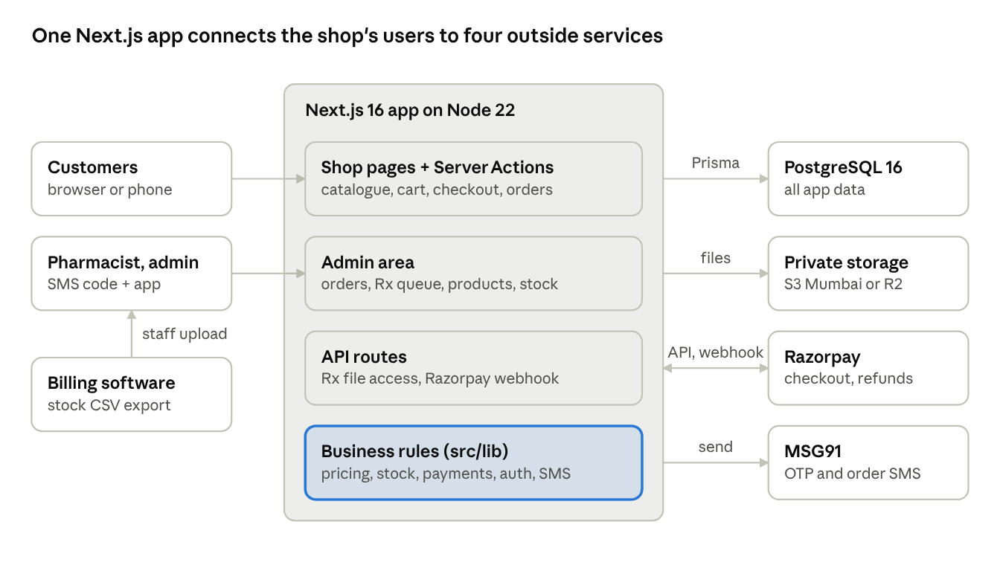
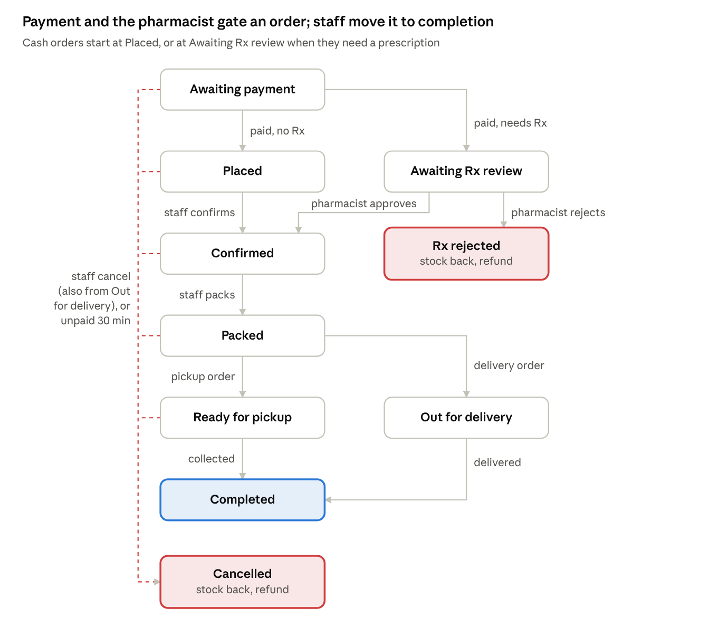

# My Pharmacy — Architecture

Oct 22, 2026 · @Ayush

## At a glance

My Pharmacy is one Next.js application that serves both the customer shop and the staff admin area, with all business rules in one shared layer. It stores everything in PostgreSQL and keeps prescription files in private storage. Payments go through Razorpay and SMS through MSG91.

Razorpay Checkout runs in the customer's browser, but the app trusts a payment only after verifying it server-side or through the signed webhook. Stock enters as a CSV that staff export from the billing software and upload.

## Code layout

The app is a single Next.js 16 project: pages and Server Actions in `src/app` stay thin, and all business rules live in `src/lib`, where pure logic sits in separate files so it can be unit-tested without a database.

| Path | Holds |
| --- | --- |
| `src/app (shop routes)` | Customer pages: `/`, `/category`, `/search`, `/product`, `/cart`, `/checkout`, `/account/*` |
| `src/app/login` | SMS-code login and the staff authenticator step (`/login/mfa`) |
| `src/app/admin` | Staff area: dashboard, orders, Rx queue, products, stock sync; its layout returns 404 to non-staff |
| `src/app/(legal)` | Privacy, terms, returns, delivery, grievance pages |
| `src/app/api` | Two route handlers: the permission-checked prescription file route and the Razorpay webhook |
| `src/lib/auth` | OTP, sessions, session policy, TOTP, recovery codes, secret encryption, SMS sender |
| `src/lib/payments` | Razorpay client (fetch-based) and the online-payment state machine |
| `src/lib/rx` | Prescription upload, file-type detection, pharmacist review |
| `src/lib` (top level) | Catalogue, cart, checkout, pricing/GST, FEFO allocation, order flow, fulfilment, invoices, notifications, stock import, product rules, storage, rate limits, security headers |
| `src/components` | Shared UI: product card, add-to-cart, search box, pay button, upload form |
| `src/generated/prisma` | Generated Prisma client (gitignored, rebuilt on install) |
| `prisma/` | `schema.prisma`, 8 migrations, sample seed |
| `scripts/` | `grant-staff.ts`, `reset-staff-mfa.ts` (run with database access) |
| `docs/production.md` | Production configuration checklist |

## Data model

PostgreSQL holds 23 tables, all through Prisma; an order is the hub that ties a customer to items, stock batches, a payment, an optional prescription, a delivery and an invoice. Money is stored as integer paise and prices include GST.

| Group | Tables | Key relations |
| --- | --- | --- |
| People and access | `User`, `Session`, `OtpChallenge`, `RecoveryCode`, `RateLimit` | User has many Sessions; staff Users have RecoveryCodes; OTPs and session tokens are stored only as hashes |
| Catalogue and stock | `Category`, `Product`, `InventoryBatch`, `InventoryImport` | Product belongs to a Category and has many Batches (quantity, reserved, expiry); imports keep a preview and history |
| Shopping | `Cart`, `CartItem`, `Address`, `ServiceArea` | Cart belongs to a User or a guest token; ServiceArea gives deliverable pincodes and fees |
| Prescriptions | `Prescription` | Belongs to a User; reviewed by a staff User; linked to Orders; file kept in private storage by key |
| Orders | `Order`, `OrderItem`, `Payment`, `Delivery`, `Invoice`, `InvoiceCounter` | Order has OrderItems (each tied to the Batch it reserved), Payments, at most one Delivery and one Invoice; InvoiceCounter numbers invoices per financial year |
| Integrations | `WebhookEvent`, `Notification` | WebhookEvent stores processed Razorpay event IDs; Notification records one SMS per order and status |
| Accountability | `AuditLog` | Actor, action and entity for sensitive actions: prescription views and decisions, status changes, refunds, product edits, imports, role changes |

## Order lifecycle

An order moves through up to ten states and ends Completed, Cancelled or Rx rejected. Payment and the pharmacist decide whether it may start; staff move every later step from the order board.

The rules live in `src/lib/order-flow.ts` (which moves staff may make) and `src/lib/fulfilment.ts` (what each move does): completing deducts stock and marks cash collected, and cancelling releases stock and refunds an online payment. Payment and prescription states never change from the order board.

## Key flows

Every state change runs in one database transaction with a guarded update ("only if still in the state I read"), so double clicks, two staff members, and repeated webhooks cannot apply a step twice.

**Login**

1. The customer enters a mobile number; the server checks per-IP and per-number limits, stores an HMAC of a 6-digit code (5-minute life, 5 guesses) and sends it by SMS.
2. A correct code creates a session: a random token in an httpOnly cookie, only its SHA-256 hash in the database. A guest cart merges into the account.
3. Staff sessions start *pending*: they grant nothing until an authenticator code (or a one-time recovery code) is entered, then are replaced by a fresh 8-hour session.

**Checkout and stock**

1. The checkout re-reads prices and stock from the database; nothing from the browser is trusted.
2. Units are allocated first-expiry-first-out across unexpired batches and *reserved* with an atomic `quantity - reserved >= n` update, which prevents overselling.
3. Prescription items require an attached, unexpired prescription and put the order in the Rx review queue.

**Online payment**

1. The order is created as *awaiting payment*; the server creates a Razorpay order for the exact total.
2. Razorpay Checkout runs in the browser. Its signed result is verified on the server, and the payment is re-read from Razorpay before it counts.
3. The webhook does the same independently (signature over the raw body, event IDs de-duplicated), so whichever arrives first settles the order.
4. Unpaid orders expire after 30 minutes and release their stock; money arriving after expiry is refunded automatically.

**Prescription review**

1. Uploads are checked by their first bytes (JPG, PNG or PDF only, 5 MB), stored under a random key in private storage, with the time of consent.
2. The pharmacist approves (doctor, date, validity) or rejects with a reason. Rejection releases stock and refunds any online payment.
3. Files are served only through `/api/prescriptions/[id]/file` to the owner or staff; every staff view is audit-logged.

**Fulfilment and notifications**

1. Staff move orders Confirmed → Packed → Ready for pickup or Out for delivery → Completed. Completion deducts stock; cancellation releases it and refunds.
2. Each status sends at most one SMS (order number only), recorded in `Notification`.
3. Paid or cash orders get a GST invoice with a gap-free number per financial year.

**Stock sync**

1. Staff upload a CSV exported from the billing software. Columns are auto-detected and rows validated, and a preview is stored.
2. Applying it is a single transaction that can only run once. Unknown item codes become hidden, prescription-only drafts for review.

## Security and data protection

Prescriptions are treated as sensitive health data under the DPDP Act: collected only with consent, stored privately in India, shown only to the owner and staff, and every staff access is logged.

| Layer | Controls |
| --- | --- |
| Identity | SMS codes stored as HMACs; session tokens stored as SHA-256 hashes; httpOnly, SameSite=Lax, Secure cookies; staff need TOTP (secrets encrypted with `MFA_ENCRYPTION_KEY`) and get 8-hour sessions; a role change ends sessions |
| Abuse limits | Per number: 3 codes per 15 minutes, 5 guesses per code. Per IP: 10 sends, 30 checks, 20 second-factor checks per 15 minutes |
| Authorisation | Staff pages and actions call `requireStaff()` and answer 404 to everyone else; customers can read only their own orders, prescriptions and invoices |
| Input | Every Server Action validates with zod; uploads are checked by content, not name; CSV rows validated before any write; redirects limited to same-site paths |
| Health data | Private storage (local disk in development, S3 Mumbai or R2 in production, server-side encrypted, no public or presigned URLs); random file keys; no medicine names in SMS or logs |
| Payments | Card and UPI details never reach the server; checkout signatures and webhooks verified with constant-time HMAC checks; amounts re-read from Razorpay |
| Browser | CSP (allows Razorpay Checkout only), HSTS, `frame-ancestors 'none'`, nosniff, no-referrer on file responses |
| Pharmacy rules | Schedule X never listed or sold; Rx items need pharmacist approval; price never above MRP; H1 register reminder |
| Secrets | Only in `.env` locally (gitignored) or the host's secrets manager; `.env.example` holds names and comments only |
| Accountability | `AuditLog` for prescription views and decisions, order status changes, refunds, product edits, stock imports and role changes |

## Design decisions

| Decision | Why |
| --- | --- |
| One Next.js app (pages, Server Actions, two API routes) instead of a separate API | One codebase and deploy for a single-store business; add a separate API only if a mobile app arrives |
| Phone OTP for customers, no passwords | Indian customers expect it; no password storage or resets to secure |
| SMS code + authenticator for staff | Staff can see health data and move money, so a SIM swap alone must not be enough |
| Integer paise, GST-inclusive prices | No floating-point rounding; matches MRP-based shelf pricing in India |
| Stock reserved at order time, deducted at handover | Online orders can't oversell, and the shop's billing software stays the source of truth for physical stock |
| CSV stock sync rather than a vendor API | Works with any billing software, no vendor accounts or keys; unknown items land as hidden drafts |
| Pay online up front for Rx orders, refund if rejected | Simpler than authorise-then-capture, and Razorpay authorisations would expire during slow reviews |
| Plain `fetch` clients for Razorpay and MSG91 | Fewer dependencies; signatures and payloads are covered by unit tests |
| Pure logic in separate files (pricing, FEFO, order flow, CSV, product rules, TOTP) | Testable without a database; 125 unit tests |
| Guarded updates instead of locks | Simple, safe under retries and concurrent staff; a stale action fails with a clear message |
| Data and files in AWS Mumbai | Keeps customer and health data in India |
